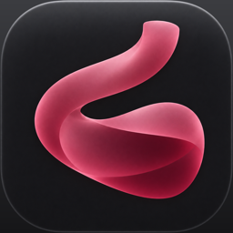

<p align="center">
  
</p>

<h1 align="center">Cellar</h1>

<p align="center">
  <strong>Run Windows games on your Mac.</strong><br>
  A native macOS app on top of Wine that sets everything up for you, including the current Windows Steam client.
</p>

<p align="center">
  <a href="https://github.com/alimicious/cellar/releases/latest"><strong>Download the latest version</strong></a>
  &nbsp;·&nbsp; <a href="docs/guide.md">Setup guide</a>
  &nbsp;·&nbsp; <a href="CHANGELOG.md">What's new</a>
</p>

---

## What it does

- **Downloads Wine for you.** Pick a runtime, and Cellar downloads, unpacks and sets it up. No Homebrew or Xcode needed.
- **Keeps games apart in bottles.** Each bottle is its own Windows install with its own C: drive and settings, stored as one folder.
- **Runs the current Windows Steam client:** sign-in, library, downloads, multiplayer and lobbies. **Install Steam** sets it up in one click, along with the fixes Steam needs to run on a Mac.
- **Runs DirectX 11 and 12 games, Steam included,** through Apple's D3DMetal with the **Wine with D3DMetal** runtime (new in 1.5.0), or DirectX 11 through DXVK with Wine Staging.
- **Shows your games as covers.** Steam games get their box art, and everything else gets a cover made from its icon. Play, set launch options or pin a game from its cover.
- **Per-bottle settings:** Windows version, MSync/ESync, Retina mode, an FPS counter, ⌘ as Ctrl, AVX, DXVK and ray tracing.
- **Game Settings for each game:** override any of those for one game, and add launch options like `-dx11`.
- **Tells you why a game won't start:** Steam not running, AVX needed, Visual C++ missing, DirectX trouble or a crash, with a one-click fix. Games with kernel anti-cheat that can't run on a Mac get a badge.
- **Playtime** for every game, counted even when you start it from Steam.
- **Performance notices** while you play, when Retina mode, Low Power Mode, heat or low memory are costing frames.
- **⌘C and ⌘V work** in Windows programs, and Option works as Alt.
- **Wine tools in a menu:** Wine settings, registry editor, task manager, control panel, Windows Explorer, and Stop All.
- **Updates itself.** From 1.2.5, **Update and Restart** installs new versions, which are signed so a tampered download is never installed.

## Download and install

**You need:**
- **macOS 26** or later
- **A Mac with Apple silicon** for the best results. Intel Macs can run the Wine Staging runtime only
- **Rosetta 2**, because Wine and Windows games are Intel code. If you've never needed it, run this once in Terminal:
  ```bash
  softwareupdate --install-rosetta --agree-to-license
  ```
- **About 4 GB of free space** for Wine, a bottle and Steam, plus room for your games

**Install:**
1. Download **Cellar-x.y.z.zip** from the [latest release](https://github.com/alimicious/cellar/releases/latest) and double-click it to unzip.
2. Drag **Cellar** into your **Applications** folder (choose **Replace** if you already have it) and open it.
3. macOS says it can't verify the app, because Cellar isn't notarized by Apple. Click **Done**, then open **System Settings → Privacy & Security**, scroll down and click **Open Anyway**. You only do this once.

## Quick start: Steam in about 15 minutes

1. **Get a runtime.** Click **Runtimes** at the bottom-left of the sidebar and download **Wine with D3DMetal** (accept Apple's D3DMetal licence when asked). On an Intel Mac, download **Wine Staging** instead.
2. **Make a bottle.** Press **⌘N**, name it "Steam", choose that runtime, keep **Windows 10**, and click **Create**. Setup takes about a minute.
3. **Install Steam.** On the bottle's page, click **Install Steam**. Cellar installs Steam and lets it update itself (about 330 MB, shown as *Updating Steam…*), then puts in the fix that lets its windows draw.
4. **Sign in and play.** Open Steam **from Cellar**, sign in (the QR code with the Steam mobile app works), install a game, and press **Play**.

Games from installers (GOG, standalone games): **Run Program…** (⌘O) and pick the game's `setup.exe` or `.msi`.

The [setup guide](docs/guide.md) covers every step, all the settings and what to do when a game won't start.

## Which runtime?

| | **Wine with D3DMetal** (554 MB) | **Wine Staging** (184 MB) | **Game Porting Toolkit** (228 MB) |
|---|---|---|---|
| **Steam** | ✅ | ✅ | ❌ The current Steam client crashes on it |
| DirectX 11 games | ✅ through D3DMetal | ✅ through DXVK | ✅ through D3DMetal |
| DirectX 12 games | ✅ through D3DMetal 4.0 (beta) | ❌ No good path | ✅ through D3DMetal 3.0 |
| DirectX 9 and older, regular apps | ✅ | ✅ | ✅ |
| Macs | Apple silicon only | Apple silicon and Intel | Apple silicon only |
| Best for | **Steam** and its games, DirectX 12 | Steam on Intel Macs, older games | Games from installers, without Steam |

You can install both, and give each bottle the runtime that suits it.

## What runs

| Game | Engine / graphics | Result |
|---|---|---|
| Worst Class Ever (demo) | Unity, DirectX 11 (DXVK) | ✅ Runs from Steam, including **multiplayer lobbies** |
| Left 4 Dead 2 | Source, DirectX 9 | ✅ Runs from Steam |
| Scam With Your Friends | Unity 6, DirectX 11 (DXVK), voice AI on the CPU | ✅ Runs. About **60 fps in game on Low** on an M4 Pro. Heavy on graphics, so start on Low. Uses the microphone |
| Persona 3 Reload | Unreal Engine 4, DirectX 12 only (D3DMetal) | ✅ Runs from Steam in a **Wine with D3DMetal** bottle. About **86 fps** on average at its default settings on an M4 Pro. Crashes at start-up in Wine Staging |

**Won't run:** games with kernel-level anti-cheat, such as Valorant, Fortnite, and many online shooters and battle royales. No translation layer can run them.

Tried a game? Open an [issue](https://github.com/alimicious/cellar/issues) with how it went, so this list can grow.

## Updates

- **From 1.2.5:** when there's a new version, a card offers **Update and Restart**. Cellar also checks once a day when it opens, and on **Cellar → Check for Updates…**.
- **Signed releases.** Each release has `Cellar-x.y.z.zip` and `Cellar-x.y.z.zip.sig`, an Ed25519 signature made with a key that never leaves the developer's Mac.
- **What Cellar checks before installing:** the signature (against the public key built into the app), the app's identity, the version and the code signature. If anything doesn't match, nothing is installed.
- **Open games keep running** while Cellar restarts.
- **1.2.4 and older** can't install updates, so download the new zip and replace the app by hand once.

Release signing key (public half, Curve25519, base64): `e9qM/et85ppButfCiCxdQsXEvIr/K6bLspVP5gFt+qU=`

## What Cellar downloads and connects to

Cellar has no accounts, ads or analytics. It contacts:

| When | What | From |
|---|---|---|
| You download a runtime | [Wine Staging 11.18](https://github.com/Gcenx/macOS_Wine_builds) or the [Game Porting Toolkit 3.0-3](https://github.com/Gcenx/game-porting-toolkit) | GitHub (builds by Gcenx) |
| You download Wine with D3DMetal | [winecx-gptk 4.8.1](https://github.com/dappermint/winecx-gptk) (Wine 11.19), and Apple's D3DMetal 4.0 beta 3 from [Sikarugir's Template 1.0.24](https://github.com/Sikarugir-App/Template) after you accept Apple's licence. Both are checked against fixed checksums | GitHub |
| You create a Wine Staging bottle | [DXVK-macOS](https://github.com/Gcenx/DXVK-macOS) 1.10.3 | GitHub |
| You click Install Steam | Steam's installer | Valve |
| Your bottle has Steam games | Their box art, looked up by Steam app ID | Valve's Steam store |
| At launch (once a day) and on Check for Updates | The latest release of this repo | GitHub |

Everything else, like Steam itself and your games, talks to its own servers as it would on Windows.

## Troubleshooting

| Problem | Try |
|---|---|
| Steam's window is black | **Wine Tools → Stop All Windows Programs**, then open Steam from Cellar again |
| Steam opens for a few seconds, then closes | The bottle uses the Game Porting Toolkit. Make a **Wine with D3DMetal** bottle for Steam (**Wine Staging** on an Intel Mac) |
| A DirectX 12 game won't start, or says DX12 isn't supported | It's in a Wine Staging bottle. Make a **Wine with D3DMetal** bottle, install Steam there and play it from that bottle |
| Play sits on "Running install script" | Normal the first time: Steam installs Visual C++ and DirectX for the game. It takes about a minute |
| "Failed to load steamui.dll" | **Stop All Windows Programs**, then open Steam from Cellar. It finishes Steam's update first |
| "Failed to initialize graphics" (Wine Staging) | Check **DXVK** is on in the bottle's settings |
| Microphone doesn't work | Allow it when macOS asks. Missed the prompt: **System Settings → Privacy & Security → Microphone → Cellar** |
| Sound plays through the speakers with headphones on | Connect headphones **before** starting the game, or restart it after switching |
| Game closes right away | Turn on **Advertise AVX**. Cellar usually tells you why a game quit |
| Low frame rate | Set the game's own graphics to **Low** first. Then check the **While you play** notices, and turn on the **FPS counter** to see the difference |

More in the [setup guide](docs/guide.md#if-a-game-wont-start).

## Questions

**Is Cellar free?** Yes.

**Does Cellar include Wine?** No. Cellar is the app around it. It downloads Wine builds made by [Gcenx](https://github.com/Gcenx), the same builds many Mac Wine tools use. Wine with D3DMetal comes from [dappermint's build](https://github.com/dappermint/winecx-gptk) of CodeWeavers' open-source CrossOver changes on Wine 11.19.

**Why does macOS warn about it?** Cellar is signed but not notarized by Apple, which needs a paid developer account. **Open Anyway** is needed once for a downloaded zip. Updates installed by Cellar itself don't ask.

**Where are my games and saves?** In their bottle, under `~/Library/Application Support/Cellar/Bottles/`. Updating Cellar never touches them.

**How do I uninstall it?** Quit Cellar, delete it from Applications, then delete `~/Library/Application Support/Cellar` (bottles and runtimes), `~/Library/Logs/Cellar` and `~/Library/Caches/Cellar`.

**Reporting a bug?** Open an [issue](https://github.com/alimicious/cellar/issues). Cellar's logs (**Wine Tools → Show Logs in Finder**) usually show what went wrong, but they contain file paths with your Mac's username, so check before you attach one.

## Credits and licences

Cellar is a front end. The hard work is done by these projects, which keep their own licences:

- [Wine](https://www.winehq.org) (LGPL), through [Gcenx's macOS builds](https://github.com/Gcenx/macOS_Wine_builds) and [dappermint's winecx-gptk](https://github.com/dappermint/winecx-gptk), which carries [CodeWeavers](https://www.codeweavers.com)' open-source CrossOver changes
- [DXVK](https://github.com/doitsujin/dxvk) (zlib licence), through [Gcenx's DXVK-macOS](https://github.com/Gcenx/DXVK-macOS)
- [MoltenVK](https://github.com/KhronosGroup/MoltenVK) (Apache 2.0), included in the Wine builds
- Apple's **Game Porting Toolkit** and **D3DMetal**, which come under Apple's own licence. Cellar's Runtimes page links to it, and Cellar asks you to accept it before downloading D3DMetal 4.0, which comes from the [Sikarugir](https://github.com/Sikarugir-App) project's release
- [Steam](https://store.steampowered.com) is Valve's. Cellar isn't affiliated with Valve, Apple, CodeWeavers or the Wine project

This repository holds release downloads and documentation. Cellar's source code is private.
